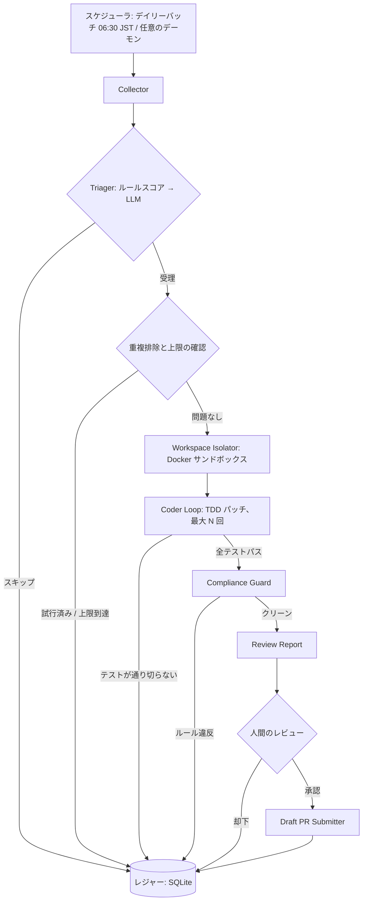

# アーキテクチャ — Autonomous OSS Contributor Agent

[English](architecture.md) | 日本語

本書は全体設計です。元のコンセプト（OSS の Issue を監視し、自律的に
修正し、プルリクエストを開く）を拡張し、他者のプロジェクトに対して
自動化を安全に運用するための仕組み — スケジューリング、状態管理、
重複排除、スコアリング、サンドボックス、人間のゲート、予算、
アンチスパム制限 — を加えています。

2026-11-11: sandbox lifecycle はPR #2でマージ済みです。今回の注入専用 CoderLoop は基準成功・assertion失敗による再現・上限付き修正・宣言した関連スイート全体・後片付けを確認します。新規mock-only 3ケースはローカル1起動で合格しました。実backend／provider、workspace adapter、自動探索・テスト作成、CLI接続、実Docker隔離は未完成・未検証です。本番はPhase 1のcollect-onlyのままです。全体完成率は未査定で、以下は有効化済み機能一覧ではありません。

## 1. 概要

システムはデイリーバッチを実行します。

1. 少数の対象リポジトリからオープン Issue を収集する。
2. 決定的スコアラー、次いで LLM でトリアージする。
3. 隔離されたサンドボックス内で、最大で数件の Issue の修正を試みる。
4. 各パッチを対象プロジェクト自身のテストスイートで検証する。
5. パッチがプロジェクトのコントリビューションルールに合うか確認する。
6. 人間に報告し、ドラフト PR を作るかどうかは人間が決める。

良い一日の成果は、ドラフト PR が 0 件か 1 件です。沈黙も正当な
結果です。何もしない方が、何かをするより常に安全であるよう
設計しています。

## 2. ゴールとノンゴール

ゴール：

1. 少数で高品質、完全に検証済みのドラフト PR を生む。
2. 各対象プロジェクトのコントリビューションルールを正確に守る。
3. 完全な監査証跡を残す。すべての判断は理由付きで記録する。
4. すべての実行のコスト（トークン、時間、計算資源）を事前に制限する。

ノンゴール：

1. PR の量やコントリビューション数を最大化すること。
2. 完全自律の提出。人間が常に PR をゲートする。
3. 大規模な機能追加、リファクタリング、設計レベルの Issue の修正。
4. プロジェクトごとのオンボーディングなしに任意のリポジトリを扱うこと。

## 3. 設計原則

1. **テストが契約である。** テストスイートが通らなければ PR はない。
2. **フェイルクローズ。** 不確実な点があれば、ログを残して試行を終える。
3. **決定的な処理が先、LLM は後。** 安いルールで大半をふるい落とし、
   モデルは境界帯の判定とパッチ作成だけを担う。
4. **プロジェクトのルールが勝つ。** 本書と対象の CONTRIBUTING.md が
   食い違えば、CONTRIBUTING.md が正しい。
5. **メンテナーの時間が最も希少な資源である。** 本設計の制限は
   すべて、それを守るためにある。

## 4. システムアーキテクチャ



コンポーネントは狭いインターフェースで分離されており、各ステージを
独立にテスト・交換できます。

## 5. パイプラインのステージ

### 5.1 Collector

有効化された各対象について GitHub API をポーリングし、対象の
監視ラベル（既定では `good first issue`、`help wanted`、`bug`、
`documentation`）の付いたオープン Issue を返します。Issue ごとに
2 つの質問にも答えます。その Issue はレジャーに既にあるか。
その Issue に対応するオープン PR（人間・ボット問わず）が既にあるか。

### 5.2 Triager

2 段階です。ルールベースのスコアラー（6 節）が明確な不合格を落とし、
明確な候補を通します。境界帯は、Issue 本文とプロジェクトルールの
要約とともに LLM に渡し、理由付きの判定を返させます。LLM の判定が
なければ試行しません。トリアージの障害時は、フィルターを緩める
のではなく実行を止めます。

### 5.3 Workspace Isolator

対象を新しい Docker サンドボックス（10 節）にクローンし、
プロジェクトのデフォルトブランチから作業ブランチを切り、ビルド
環境を準備します。1 試行に 1 サンドボックス、終了後は必ず破棄します。

### 5.4 Coder Loop（TDD）

1. 探索：関連コードと既存テストを特定する。
2. 再現：その Issue で失敗するテストを作成または特定する。
   再現できなければ試行を終える（失敗種別：`not_reproduced`）。
3. パッチ：Issue を直す最小の変更を当てる。
4. 検証：サンドボックスでプロジェクトのテストコマンドを実行する。
5. 修復：失敗したらテスト出力を返して再試行する。上限は
   `max_patch_attempts`（`configs/agent_rules.yaml` の既定は 5）。

成功条件は、新しいテストだけでなく、関連テストスイート全体が
パスすることです。

### 5.5 Compliance Guard

完成したパッチをプロジェクトごとのルール（9 節）に照らして検証
します。lint と format のコマンドが通ること、コミットメッセージが
プロジェクトの規約に従うこと、必要な場合は DCO の Signed-off-by が
あること、差分が関連ファイルのみに触れていること。違反があれば
パッチを破棄するか Coder Loop に差し戻します。そのまま出荷する
ことは決してしません。

### 5.6 Review Report

試行ごとのレポート（と、試行を横断するデイリーダイジェスト）には
次を含みます。Issue の要約、トリアージスコアとその理由、何をなぜ
変えたか、実行したテストコマンドと結果の正確な記録、差分の
プレビュー。レポートはローカルの `reports/` に置かれ、スケジュール
実行時は CI アーティファクトとして、またダイジェストとして
運用者に届きます。

### 5.7 PR Submitter

人間がレポートを明示的に承認した後にのみ動きます。ブランチを
運用者の fork に push し、プロジェクトの PR テンプレートで
**ドラフト** PR を開きます。本文には AI 支援の開示文が含まれます。
PR をレビュー可能にすることも、マージすることもできません。

## 6. トリアージスコアリングのルーブリック

`src/collector/triager.py`（`score_issue`）に実装されています。
スコアは [0.0, 1.0] の範囲で、理由リストによって完全に説明できます。

| シグナル | 点数 |
| --- | --- |
| ラベル `good first issue` | +0.25 |
| ラベル `help wanted` | +0.20 |
| ラベル `documentation` / `docs` | +0.20 |
| ラベル `bug` | +0.15 |
| ラベル点の合計 | +0.35 で上限 |
| ラベル `feature request` / `feature-request` | −0.15（据え置き） |
| bug 種別で再現手順がある | +0.20 |
| request 種別のユースケース／具体例／期待結果 | 各 +0.10、合計 +0.20 が上限 |
| Issue 内でテストに言及がある | +0.15 |
| 本文 400 字以上 | +0.10 |
| 本文 150〜399 字 | +0.05 |
| 本文 150 字未満 | +0.00 |
| タイトルに狭スコープのキーワード（typo、docs、readme など） | +0.15 |
| 広スコープのキーワード（epic、umbrella、roadmap、redesign、overhaul） | −0.10 |

判定帯（`configs/agent_rules.yaml` より）：

| スコア | 判定 |
| --- | --- |
| 0.60 以上 | 既存 PR チェック後に候補（Phase 1 は保存のみ） |
| 0.40 以上 0.60 未満 | 境界帯：LLM トリアージが決める（未設定時は `pending_llm`） |
| 0.40 未満 | スキップ：レジャーに記録し、盲目には再試行しない |

種別は `bug` ラベル、または本文から再現手順を検出できた場合に bug、
それ以外（機能要望・改善・ドキュメント作業を含む）は request とします。
bug は再現手順だけを本文の種別別シグナルとして評価し、request は
ユースケース・具体例・期待結果を評価します。両方の加点を重ねません。
再現手順がない request に再現不足の理由は付けません。

検出は簡易ヒューリスティックです。再現手順は `Steps to reproduce` 等の
マーカーとその後の内容（空見出しだけは除外）、ユースケースは `Use case`
等、具体例はコードフェンス・`Example:`・「例えば」、期待結果は
`Expected behavior`・`Acceptance criteria` 等から導出します。
内容の正しさや十分さを保証する検査ではありません。

本文の種別別加点は `rules.triage_scoring` の `reproduction_points`（0.20）、
`detail_signal_points`（0.10）、`detail_points_cap`（0.20）で設定します。
各値は 0〜1 の有限数で、bool・文字列・不正なマッピングは `ConfigError`
になります。省略した項目には既定値を使います。

デイリーダイジェストの「現在の候補プール」はレジャー全体の
`outcome = candidate` を対象とし、今回判定しなかった既存候補も表示します。
リポジトリ、初回観測日時、Issue 番号の順で、タイトル・リンク・スコア・
初回観測日からの経過日数（最小 0 日）を表示し、0 件なら空と明記します。
スキーマ変更はなく、Phase 1 でパッチや PR を作る処理には接続しません。
既存の終端判定は自動で再採点せず、候補のクローズ状態も再確認しません。

根拠：ラベルはメンテナー自身によるスコープ設定の表明なので最も
重くします。再現手順とテストへの言及は、TDD ループが始められるか
を予測します。本文の長さは仕様の質の弱い代理指標です。スコープの
キーワードは、2 つの典型的な失敗形 — 小さく固定された修正（良い）と
複合的なエピック（悪い）— を拾います。

## 7. スケジューリング設計

主モード：**デイリーバッチ**。

- GitHub Actions の cron が 06:30 JST（UTC `30 21 * * *`）に実行します。
- バッチは前回実行以降に公開・更新された Issue を収集し、トリアージ
  し、`max_issues_attempted_per_day`（既定 3）件まで試行して、
  ドラフト PR 候補を `max_draft_prs_per_day`（既定 1）件まで生みます。
- 実行の最後に、結果ゼロの場合（「今日は試す価値のあるものは
  なかった」）を含め、ダイジェストレポートを運用者に届けます。

副モード：**ウォッチデーモン**（任意）。

- `scripts/watch_repos.py --daemon` は、新しい `good first issue`
  ラベルに当日中に反応したい運用者向けに、より長い間隔で
  ポーリングします。
- デーモンはまったく同じレジャー、上限、ゲートに従います。
  スケジューリングの変種であって、ポリシーの変種ではありません。

どちらのモードも再開可能です。進捗はすべてレジャーにあるため、
クラッシュした実行は作業のやり直しではなく状態の再読み込みで
再開します。

## 8. 状態とレジャーの設計

単一の SQLite データベース（`state/ledger.sqlite3`、git 管理外）が
システムの記憶です。目にしたすべての (repo, issue) に 1 行：

| 列 | 意味 |
| --- | --- |
| repo, issue_number | 主キー |
| first_seen_at, last_seen_at | 観測期間 |
| triage_score, triage_reasons | ルールスコアラーの出力 |
| llm_verdict | 境界帯の判定（あれば） |
| outcome | skipped / attempted / tests_failed / compliance_failed / report_ready / draft_created / human_rejected |
| attempts_used | 消費したパッチ試行回数 |
| pr_url | ドラフト PR が作られた場合に設定 |
| updated_at | 最終状態変更 |

ルール：

1. 試行結果が記録された Issue は、自動では二度と試行しません。
   人間が意図的に行をリセットすることはできます。
2. 試行の前に、Collector はその Issue を参照する既存 PR を確認
   します。人間・ボットを問わず、1 件でもあればスキップします。
3. プロジェクトごとのクールダウン：あるプロジェクトで試行したら、
   `per_project_cooldown_days`（既定 3 日）の間、そのプロジェクトの
   新規試行はしません。
4. 週次上限：レジャーの履歴から強制し、プロジェクトごとに
   `max_draft_prs_per_project_per_week`（既定 2）件まで。

この規模（対象は数件、Issue は 1 日数件）では SQLite で十分であり、
運用も簡単です。バックアップはファイル 1 つ、サーバーは不要です。

## 9. プロジェクトごとのルール

`configs/targets.yaml` の各対象は、そのプロジェクトの礼儀正しい
コントリビューターとして振る舞うために必要な情報をすべて持ちます：

- 監視ラベルと言語
- build / test / lint / format のコマンド
- デフォルトブランチとブランチ接頭辞
- コミットメッセージ規約
- DCO と CLA の要件
- PR テンプレートの場所

プロジェクトのオンボーディングは人間の仕事です。CONTRIBUTING.md と
PR テンプレートを読み、フィールドを埋め、コマンドを一度手で実行
して確認し、それから初めて `enabled: true` にします。未確認の
フィールドは設定内で `check CONTRIBUTING.md` または `to-verify` と
印され、パイプラインは未確認フィールドを「推測すべき既定値」では
なく停止条件として扱います。

プロジェクトが機械可読な場所（lint 設定、Makefile のターゲット、
PR テンプレートファイル）にルールを示している場合、サンドボックス
実行ではそれらを直接使います。YAML は索引であり、置き換えでは
ありません。

## 10. サンドボックスとセキュリティ

Coder Loop はモデルが生成したコマンドを、クローンしたリポジトリに
対して実行します。そのためサンドボックスは敵対的コードの実行環境
として扱います：

1. **隔離。** 1 試行に 1 つの Docker コンテナ。試行間の共有状態は
   なく、ワークスペースは終了時に削除します。
2. **内部に認証情報を置かない。** GitHub トークンと LLM API キーは
   オーケストレータのプロセス内にだけあります。サンドボックスが
   受け取るのはソースコードと、パッチ段階ではキーを保持する
   プロキシ経由のモデル呼び出し（あるいは適用すべきパッチ）です。
   漏洩させうる秘密を目にすることは決してありません。
3. **外部送信の制限。** ソース・依存取得は、取得先制御と検証が必要な
   将来の別段階です。テスト実行時はネットワークを無効にします。
   今回の backend 契約は `network=none` 固定で、clone・依存取得や
   ネットワーク有効化の経路を追加しません。
4. **リソース制限。** 今回は CPU・メモリ・試行全体の期限、各 lifecycle
   操作の期限、コマンド数・入力バイト数・合算出力バイト数の上限を
   immutable policy として backend に渡します。既定の試行期限は45分、
   create/start/remove は各30秒、32コマンド、入力16 KiB・合算出力64 KiBです。
   期限切れ後の remove にも独立した30秒の猶予を渡します。backend が
   実行中の kill・出力収集時の上限・呼出し側が idle な間の寿命を強制します。
   Python 側の検査では backend の停止や既に割り当てられたメモリを
   制御できません。ディスク上限や本番設定との接続は未実装です。
5. **非 root、最小の表面。** コンテナは非 root ユーザーで動き、
   対象プロジェクトに必要なツールチェーンだけを持ちます。

`Sandbox(image, cpu_limit, memory_limit_mb, *, backend=...)` は従来の位置引数、
context manager、`run(command, timeout_seconds)` と `CommandResult` を維持します。
policy は読取専用です。backend 未注入は明示拒否し、自動選択やホスト実行への
fallback はありません。create より前に決めた attempt ID を全操作に渡し、
不確実な create、部分 start、実行例外・timeout でも同じ ID で remove を1回だけ
試みます。失敗した試行は再利用せず、remove 不確実時は `SandboxCleanupError` に
元の例外と cleanup 例外・ID を保持し、人間による状態照合が必要です。
コマンドの終了コード0だけでは試行成功にならず、context 終了も必要です。
ここまでの強制力は信頼できる adapter の実装と実隔離試験を待つ契約です。

## 11. Human-in-the-Loop のゲート

ゲートは 3 つあり、エージェントはどれも自力で通過できません：

1. **対象ゲート。** 各プロジェクトのオンボーディングと有効化は
   人間が行います（9 節）。エージェントがプロジェクトを有効化
   することは決してありません。
2. **レポートゲート。** ドラフト PR は、人間がレビューレポート
   （要約、テストログ、差分プレビュー）を読んで、その試行を承認
   した場合にのみ作られます。
3. **提出ゲート。** エージェントが作るのはドラフト PR のみです。
   PR をレビュー可能にすること、メンテナーのフィードバックへの
   応答、マージは人間の行為であり、本システムの範囲外です。

さらに、すべての PR 本文には AI 支援の開示文が含まれます。
機械の作業を支援なしの人間の作業と見せかけることは、13 節の
倫理に反します。

## 12. 制限とフェイルクローズポリシー

全体の制限は `configs/agent_rules.yaml` にあります：

| 制限 | 既定値 |
| --- | --- |
| Issue ごとのパッチ試行上限 | 5 |
| Issue ごとのタイムアウト | 45 分 |
| Issue ごとのトークン予算 | 200,000（仮置き） |
| 1 日のトークン予算 | 1,000,000（仮置き） |
| 1 日の時間予算 | 120 分 |
| 1 日に試行する Issue の上限 | 3 |
| 1 日のドラフト PR 上限 | 1 |
| プロジェクトごとの週次ドラフト PR 上限 | 2 |
| プロジェクトごとのクールダウン | 3 日 |

いずれかの予算を超えたら、実行はきれいに止まります。進行中の
試行は中止し、状態をレジャーに書き、ダイジェストで理由を説明します。

フェイルクローズの誘因（スキップして記録、決して推測しない）：

- 失敗するテストで Issue を再現できない。
- テストスイートが不安定（変更なしに同じテストが通ったり落ちたりする）。
- プロジェクトのルールが欠けている、矛盾している、未確認である。
- その Issue に対応する PR が既にある。
- トリアージ LLM が使えない、または解釈できない判定を返す。
- サンドボックスやコンプライアンスの確認がエラーになる。

## 13. アンチスパム倫理

本節は後付けの方針ではなく、設計上の制約です。

1. **少数精鋭が量に勝る。** 12 節の上限は、メンテナーがこの
   エージェントを目にするのは稀で、しかも検証済みの作業でのみ
   あるよう設定されています。
2. **オプトアウトを尊重する。** プロジェクトが AI 生成の
   コントリビューションを禁じている場合、またはメンテナーから
   停止を求められた場合、対象は即時かつ恒久的に無効化します。
   プロジェクト自身による撤回が記録された場合のみ例外です。
3. **通りすがりの騒音を作らない。** 試行しない Issue にはコメント
   せず、追跡用 Issue を開かず、却下された PR を見た目だけ変えて
   再試行しません。
4. **開示する。** すべての PR に、AI エージェントがドラフトを
   用意し人間がレビューした旨を記します（11 節）。
5. **単一の身元。** すべての活動は運用者自身のアカウントと fork で
   行い、帰属可能でブロック可能にします。

## 14. 失敗の分類

すべての試行はちょうど 1 つの結果で終わり、レジャーに記録されます：

| 種別 | 意味 |
| --- | --- |
| `skipped_low_score` | ルールトリアージがスキップ閾値未満 |
| `skipped_llm_reject` | 境界帯の Issue を LLM トリアージが却下 |
| `skipped_duplicate` | 試行済み、または既存 PR がカバーしている |
| `skipped_cap` | 日次・週次上限またはプロジェクトのクールダウンが効いている |
| `not_reproduced` | 失敗するテストを作れなかった |
| `tests_failed` | パッチ試行を使い切り、スイートがまだ赤い |
| `timeout` | 試行中に Issue ごと・1 日の予算を使い切った |
| `compliance_failed` | lint・format・規約・サインオフ違反 |
| `report_ready` | 成功：レポートを届け、人間待ち |
| `draft_created` | 人間が承認し、ドラフト PR が存在する |
| `human_rejected` | 人間がレポートを却下した |
| `infra_error` | API、サンドボックス、ツールの障害（ログ参照） |

この分類があるからデイリーダイジェストが正直になります。種別ごとの
失敗数を見れば、システムが厳しすぎるのか、緩すぎるのか、単に
狙う Issue を間違えているのかが一目で分かります。

## 15. メトリクスと可観測性

実行ごとに、システムは次を記録し報告します：

- 目にした Issue / トリアージで除外（帯ごと）/ 試行 / 成功 の数
- Issue ごとのパッチ試行回数、ステージごとのトークンと実時間の消費
- 用意したドラフト、承認、却下の数
- 種別ごとの失敗数（14 節）

出力先：

- **実行ログ**：構造化され、実行ごとに `logs/` 配下に 1 ファイル。
- **デイリーダイジェスト**：運用者向けの要約（5.6 節）。スケジュール
  実行時は CI アーティファクトとしてもアップロードされます。
- **レジャー**：長期記録（8 節）。週次の集計（受け入れ率、
  メンテナーの反応）はここから計算します。

テレメトリが運用者の環境の外に出ることはありません。対象
プロジェクトが目にするのは、人間が承認したドラフト PR だけです。

## 16. リポジトリ構成

```text
configs/            targets.yaml（プロジェクトごとのルール）、agent_rules.yaml（制限）
docs/               本設計（英語と日本語）
scripts/            run_agent.py（単一 Issue）、watch_repos.py（バッチ／デーモン）
src/collector/      github_client.py、triager.py
src/sandbox/        docker_manager.py、git_workspace.py
src/agent/          core.py（Coder Loop）、prompts.py、tools.py
src/review/         compliance.py、pr_builder.py
tests/              pytest スイート（triager はカバー済み、フェーズごとに拡充）
.github/workflows/  ci.yml、daily-triage.yml（06:30 JST、レポートモード）
state/              ledger.sqlite3（git 管理外、実行時に作成）
```

## 17. ロードマップ

- **Phase 0 — 設計とスキャフォールド（現在）。** ドキュメント、設定、
  モジュールスケルトン、テスト付きで動作するトリアージスコアラー、
  CLI のドライラン、CI。
- **Phase 1 — Collector とトリアージ。** GitHub クライアント、
  レジャー、既存 PR チェック、境界帯への LLM トリアージ、
  デイリーダイジェスト。このフェーズではコード変更を一切試みません。
- **Phase 2 — サンドボックスと Coder Loop。** Docker 隔離、TDD
  パッチループ。対象は 1 プロジェクトのドキュメントとタイポの
  Issue のみ、レポートは手でレビューします。PR はまだ作りません。
- **Phase 3 — コンプライアンスとドラフト PR。** コンプライアンス
  ガード、レポートゲート、PR テンプレートからの開示付きドラフト
  PR 提出。
- **Phase 4 — 定期運用。** デイリーバッチを本番運用し、対象
  プロジェクトは 1 つずつ有効化します。上限の引き上げは、
  スケジュールではなく、レジャーにメンテナーの受け入れ実績
  （マージ、または前向きなレビューを受けたドラフト）が示された
  場合にのみ行います。

## 18. 未解決の問題と未検証の前提

ここで推測することは 3 節に反するので、正直に並べます：

1. **プロジェクトごとの CLA/DCO の具体は未検証です。** 初期の対象は
   コントリビューション契約やサインオフ要件を持つことで知られて
   いますが、正確な仕組み（CLA アシスタント、DCO ボット、
   ライセンスヘッダー）は、ドラフト PR が可能になる前に、
   オンボーディング時（9 節）にプロジェクトごとに確認が必要です。
   人間の署名が必要な CLA は、エージェントが用意する作業にとって
   ハードゲートになりえます。
2. **GitHub API のレート制限。** デイリーバッチでは使用量は小さく
   抑えられますが、大規模リポジトリ横断の検索による重複チェックは
   二次レート制限に当たる可能性があります。Collector は積極的に
   リトライせず、バックオフしなければなりません。正確な予算は
   Phase 1 で実測します。
3. **GitHub Actions の分数と Docker の可用性。** 大規模な Go
   リポジトリ（Grafana、Mattermost）はビルドが重く、無料／標準の
   Actions ランナーで Issue ごとのタイムアウト内にビルドとテスト
   ができるかは未検証です。フォールバックはセルフホストランナー
   （ホームラボ）で、別途セキュリティレビューが必要です。
4. **テストスイートの実行時間。** モノレポでは「全スイートのパス」は
   現実的でない場合があります。Phase 2 では、契約を弱めない範囲で、
   プロジェクトごとに「関連テストスイート」の意味（影響を受ける
   パッケージ）を定義しなければなりません。
5. **プロジェクトごとの fork と PR の作法。** プロジェクトによっては、
   作業の宣言コメント、ラベルの付与、コードの前に議論が必要な
   場合があります。これらの規範はプロジェクトごとに異なり、
   現在は未検証です。確認でき次第 `configs/targets.yaml` に入れます。
6. **LLM トリアージの品質。** 境界帯では LLM の判定がルール
   スコアラーより正確だという前提は、Phase 1 で手ラベル付き Issue
   に対して検証すべき仮説であり、事実ではありません。
