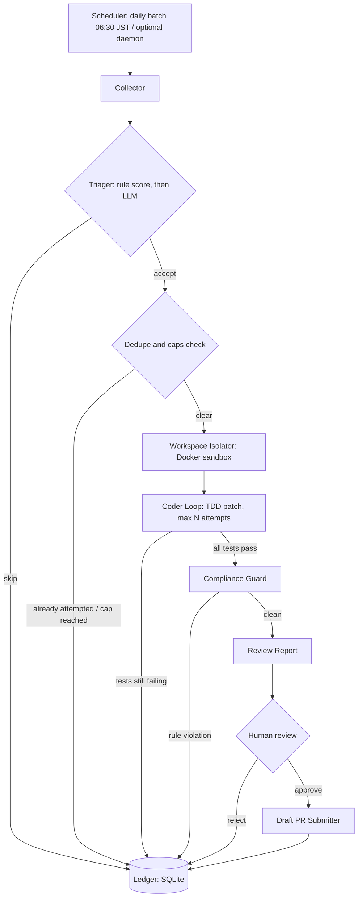

# Architecture — Autonomous OSS Contributor Agent

English | [日本語](architecture.ja.md)

This document is the overall design. It expands the original concept
(watch OSS issues, fix them autonomously, open pull requests) with the
operational machinery that makes automation safe to run against other
people's projects: scheduling, state, dedupe, scoring, sandboxing,
human gates, budgets, and anti-spam limits.

## 1. Overview

The system runs a daily batch that:

1. Collects open issues from a small set of target repositories.
2. Triages them with a deterministic scorer, then an LLM.
3. Attempts a fix for at most a few issues, inside isolated sandboxes.
4. Verifies each patch with the target project's own test suite.
5. Checks the patch against the project's contribution rules.
6. Reports to a human, who decides whether a draft PR is created.

The output of a good day is zero or one draft PRs. Silence is a valid
result. The system is designed so that doing nothing is always safer
than doing something.

## 2. Goals and non-goals

Goals:

1. Produce a small number of high-quality, fully verified draft PRs.
2. Obey each target project's contribution rules exactly.
3. Keep a complete audit trail: every decision is logged with reasons.
4. Bound the cost (tokens, time, compute) of every run in advance.

Non-goals:

1. Maximizing PR volume or contribution counts.
2. Fully autonomous submission. A human always gates the PR.
3. Fixing large features, refactors, or design-level issues.
4. Supporting arbitrary repositories without per-project onboarding.

## 3. Design principles

1. **Tests are the contract.** No passing test suite, no PR.
2. **Fail closed.** Any uncertainty ends the attempt, with a log entry.
3. **Deterministic first, LLM second.** Cheap rules filter the bulk;
   the model only judges the borderline band and writes patches.
4. **The project's rules win.** Where this document and a target's
   CONTRIBUTING.md disagree, CONTRIBUTING.md is right.
5. **Maintainers' time is the scarcest resource.** Every limit in
   this design exists to protect it.

## 4. System architecture



Components are separate processes/stages with narrow interfaces, so
each stage can be tested and replaced independently.

## 5. Pipeline stages

### 5.1 Collector

Polls the GitHub API for each enabled target and returns open issues
carrying any of the target's watch labels (`good first issue`,
`help wanted`, `bug`, `documentation` by default). It also answers
two questions per issue: is the issue already in the ledger, and does
an open PR (human or bot) already address it?

### 5.2 Triager

Two stages. The rule-based scorer (section 6) drops clear rejects and
passes clear candidates. The borderline band goes to an LLM with the
issue text and the project's rules summary; it must return a verdict
with reasons. No LLM verdict, no attempt — a triage outage stops the
run rather than loosening the filter.

### 5.3 Workspace Isolator

Clones the target into a fresh Docker sandbox (section 10), checks
out a working branch from the project's default branch, and prepares
the build environment. One sandbox per attempt, always destroyed
afterwards.

### 5.4 Coder Loop (TDD)

1. Explore: locate relevant code and existing tests.
2. Reproduce: write or identify a test that fails for this issue.
   If reproduction fails, the attempt ends (failure kind:
   `not_reproduced`).
3. Patch: apply the smallest change that fixes the issue.
4. Verify: run the project's test command in the sandbox.
5. Repair: on failure, retry with the test output, up to
   `max_patch_attempts` (default 5 in `configs/agent_rules.yaml`).

Success requires the full relevant test suite to pass, not just the
new test.

### 5.5 Compliance Guard

Verifies the finished patch against the per-project rules (section
9): lint and format commands pass, commit messages follow the
project's convention, DCO sign-off is present where required, and
the diff touches only relevant files. Any violation discards the
patch or returns it to the coder loop — never ships as-is.

### 5.6 Review Report

A per-attempt report (and a daily digest across attempts) containing:
the issue summary, the triage score and reasons, what changed and
why, the exact test commands run with their results, and a diff
preview. Reports land in `reports/` locally and, in scheduled mode,
as CI artifacts plus a digest delivered to the operator.

### 5.7 PR Submitter

Runs only after explicit human approval of a report. It pushes the
branch to the operator's fork and opens a **draft** PR using the
project's PR template, with the AI-assistance disclosure line in the
body. It cannot mark a PR ready for review and cannot merge.

## 6. Triage scoring rubric

Implemented in `src/collector/triager.py` (`score_issue`). Scores are
in [0.0, 1.0] and fully explained by a reasons list.

| Signal | Points |
| --- | --- |
| Label `good first issue` | +0.25 |
| Label `help wanted` | +0.20 |
| Label `documentation` / `docs` | +0.20 |
| Label `bug` | +0.15 |
| Label points total | capped at +0.35 |
| Label `feature request` | −0.15 |
| Reproduction steps present | +0.20 |
| Tests mentioned in the issue | +0.15 |
| Body ≥ 400 chars | +0.10 |
| Body 150–399 chars | +0.05 |
| Body < 150 chars | +0.00 |
| Narrow-scope keyword in title (typo, docs, readme, …) | +0.15 |
| Broad-scope keyword (epic, umbrella, roadmap, redesign, overhaul) | −0.10 |

Decision bands (from `configs/agent_rules.yaml`):

| Score | Decision |
| --- | --- |
| ≥ 0.60 | Accept: candidate for a sandbox attempt |
| 0.40 – 0.60 | Borderline: LLM triage decides |
| < 0.40 | Skip: recorded in the ledger, never retried blindly |

Rationale: labels express the maintainers' own scoping, so they weigh
most. Reproduction steps and mentioned tests predict whether a TDD
loop can even start. Body length is a weak proxy for specification
quality. Scope keywords catch the two classic failure shapes — tiny
well-pinned fixes (good) and multi-part epics (bad).

## 7. Scheduling design

Primary mode: **daily batch**.

- A GitHub Actions cron runs at 06:30 JST (`30 21 * * *` UTC).
- The batch collects issues published or updated since the last run,
  triages, and attempts at most `max_issues_attempted_per_day`
  (default 3) issues, producing at most `max_draft_prs_per_day`
  (default 1) draft-PR candidates.
- The run ends with a digest report to the operator, including the
  zero-result case ("nothing worth attempting today").

Secondary mode: **watch daemon** (optional).

- `scripts/watch_repos.py --daemon` polls at a longer interval for
  operators who want same-day reaction to new `good first issue`
  labels.
- The daemon obeys exactly the same ledger, caps, and gates. It is a
  scheduling variant, not a policy variant.

Both modes are resumable: all progress lives in the ledger, so a
crashed run restarts by re-reading state, not by redoing work.

## 8. State and ledger design

A single SQLite database (`state/ledger.sqlite3`, git-ignored) is the
system's memory. One row per (repo, issue) ever seen:

| Column | Meaning |
| --- | --- |
| repo, issue_number | Primary key |
| first_seen_at, last_seen_at | Observation window |
| triage_score, triage_reasons | Rule-scorer output |
| llm_verdict | Borderline-band decision, if any |
| outcome | skipped / attempted / tests_failed / compliance_failed / report_ready / draft_created / human_rejected |
| attempts_used | Patch attempts consumed |
| pr_url | Set when a draft PR was created |
| updated_at | Last state change |

Rules:

1. An issue with any recorded attempt outcome is never attempted
   again automatically. A human can reset a row deliberately.
2. Before any attempt, the collector checks for existing PRs that
   reference the issue. Any hit — human or bot — skips the issue.
3. Per-project cooldown: after an attempt on a project, no new
   attempt on that project for `per_project_cooldown_days`
   (default 3).
4. Weekly cap: at most `max_draft_prs_per_project_per_week`
   (default 2) draft PRs per project, enforced from ledger history.

SQLite is enough at this scale (a handful of targets, a few issues
per day) and keeps operations trivial: one file to back up, no server.

## 9. Per-project rules

Each target in `configs/targets.yaml` carries everything the pipeline
needs to behave like a respectful contributor to that project:

- watch labels and languages
- build / test / lint / format commands
- default branch and branch prefix
- commit message convention
- DCO and CLA requirements
- PR template location

Onboarding a project is a human task: read CONTRIBUTING.md and the PR
template, fill the fields, verify the commands by running them once
by hand, and only then set `enabled: true`. Fields that have not been
verified are marked `check CONTRIBUTING.md` or `to-verify` in the
config, and the pipeline treats an unverified field as a stop
condition, not as a default to guess.

Where the project states its rules in machine-readable places (lint
configs, Makefile targets, PR template files), the sandbox run uses
those directly; the YAML is the index, not a replacement.

## 10. Sandbox and security

The coder loop runs model-generated commands against a cloned
repository, so the sandbox is treated as a hostile-code environment:

1. **Isolation.** One Docker container per attempt; no shared state
   between attempts; workspace deleted on teardown.
2. **No credentials inside.** The GitHub token and LLM API keys live
   in the orchestrator process only. The sandbox receives source code
   and, for the patch stage, calls the model through a proxy that
   holds the key — or receives a patch to apply. It never sees a
   secret it could exfiltrate.
3. **Restricted egress.** Network access is limited to the initial
   clone and the package registries the project's build needs.
   Everything else is denied by default.
4. **Resource limits.** CPU, memory, disk, and wall-clock limits come
   from `configs/agent_rules.yaml` (per-issue timeout default
   45 minutes). A runaway build is killed, and the attempt is logged
   as `timeout`.
5. **Non-root, minimal surface.** Containers run as a non-root user
   with only the toolchain the target project needs.

## 11. Human-in-the-loop gates

There are three gates, and the agent cannot pass any of them itself:

1. **Target gate.** A human onboards and enables each project
   (section 9). No project is ever enabled by the agent.
2. **Report gate.** A draft PR is created only after a human has
   read the review report (summary, test logs, diff preview) and
   approved that specific attempt.
3. **Submission gate.** The agent creates draft PRs only. Marking a
   PR ready for review, responding to maintainer feedback, and
   merging are human actions, outside this system.

Additionally, every PR body carries an AI-assistance disclosure
line. Passing off machine work as unaided human work would violate
the ethics in section 13.

## 12. Limits and fail-closed policy

Global limits live in `configs/agent_rules.yaml`:

| Limit | Default |
| --- | --- |
| Max patch attempts per issue | 5 |
| Per-issue timeout | 45 min |
| Per-issue token budget | 200,000 (placeholder) |
| Daily token budget | 1,000,000 (placeholder) |
| Daily time budget | 120 min |
| Max issues attempted per day | 3 |
| Max draft PRs per day | 1 |
| Max draft PRs per project per week | 2 |
| Per-project cooldown | 3 days |

Exceeding any budget stops the run cleanly: in-flight attempts are
aborted, state is written to the ledger, and the digest explains why.

Fail-closed triggers (skip + log, never guess):

- Issue cannot be reproduced with a failing test.
- Test suite is flaky (same test passes and fails without changes).
- Project rules are missing, contradictory, or unverified.
- An existing PR already addresses the issue.
- Triage LLM is unavailable or returns an unparseable verdict.
- Any sandbox or compliance check errors out.

## 13. Anti-spam ethics

This section is a design constraint, not a policy afterthought.

1. **Few and good beats many.** The caps in section 12 are set so a
   maintainer sees this agent rarely, and only with verified work.
2. **Respect opt-outs.** If a project forbids AI-generated
   contributions, or a maintainer asks us to stop, the target is
   disabled immediately and permanently unless the human operator
   documents a reversal by the project itself.
3. **No drive-by noise.** The agent never comments on issues it does
   not attempt, never opens tracking issues, and never re-attempts a
   rejected PR with cosmetic changes.
4. **Disclose.** Every PR states that an AI agent prepared the draft
   and a human reviewed it (section 11).
5. **One identity.** All activity happens under the operator's own
   account and fork, attributable and blockable.

## 14. Failure taxonomy

Every attempt ends with exactly one outcome, recorded in the ledger:

| Kind | Meaning |
| --- | --- |
| `skipped_low_score` | Rule triage below the skip threshold |
| `skipped_llm_reject` | Borderline issue rejected by LLM triage |
| `skipped_duplicate` | Already attempted, or an existing PR covers it |
| `skipped_cap` | Daily/weekly cap or project cooldown in force |
| `not_reproduced` | No failing test could be produced |
| `tests_failed` | Patch attempts exhausted, suite still red |
| `timeout` | Per-issue or daily budget exhausted mid-attempt |
| `compliance_failed` | Lint/format/convention/sign-off violation |
| `report_ready` | Success: report delivered, awaiting human |
| `draft_created` | Human approved; draft PR exists |
| `human_rejected` | Human rejected the report |
| `infra_error` | API, sandbox, or tooling failure (see logs) |

The taxonomy is what makes the daily digest honest: failure counts
by kind show at a glance whether the system is too strict, too loose,
or simply pointed at the wrong issues.

## 15. Metrics and observability

Per run, the system records and reports:

- issues seen / triaged out (by band) / attempted / succeeded
- patch attempts used per issue; token and wall-clock spend per stage
- drafts prepared, approved, rejected
- failure counts by kind (section 14)

Outputs:

- **Run logs**: structured, one file per run under `logs/`.
- **Daily digest**: the operator-facing summary (section 5.6), also
  uploaded as a CI artifact in scheduled mode.
- **Ledger**: the long-term record (section 8); weekly aggregates
  (acceptance rate, maintainer response) are computed from it.

No telemetry leaves the operator's environment. Target projects see
only the draft PRs a human approved.

## 16. Repository layout

```text
configs/            targets.yaml (per-project rules), agent_rules.yaml (limits)
docs/               this design, in English and Japanese
scripts/            run_agent.py (single issue), watch_repos.py (batch/daemon)
src/collector/      github_client.py, triager.py
src/sandbox/        docker_manager.py, git_workspace.py
src/agent/          core.py (coder loop), prompts.py, tools.py
src/review/         compliance.py, pr_builder.py
tests/              pytest suite (triager covered; more per phase)
.github/workflows/  ci.yml, daily-triage.yml (06:30 JST, report mode)
state/              ledger.sqlite3 (git-ignored, created at runtime)
```

## 17. Roadmap

- **Phase 0 — Design and scaffold (current).** Documents, configs,
  module skeleton, working triage scorer with tests, CLI dry-runs,
  CI.
- **Phase 1 — Collector and triage.** GitHub client, ledger,
  existing-PR check, LLM triage for the borderline band, daily
  digest. No code changes are attempted in this phase.
- **Phase 2 — Sandbox and coder loop.** Docker isolation, TDD patch
  loop, exercised only on documentation and typo issues in one
  target, with reports reviewed by hand. No PRs yet.
- **Phase 3 — Compliance and draft PRs.** Compliance guard, report
  gate, draft PR submission from the PR template with disclosure.
- **Phase 4 — Scheduled operation.** Daily batch in production,
  targets enabled one at a time. Caps are raised only when the
  ledger shows maintainer acceptance (merged or positively reviewed
  drafts), never on a schedule.

## 18. Open questions and unverified assumptions

Stated plainly, because guessing here would violate section 3:

1. **Per-project CLA/DCO specifics are unverified.** The initial
   targets are known to have contribution agreements or sign-off
   requirements, but the exact mechanism (CLA assistant, DCO bot,
   license headers) must be confirmed per project during onboarding
   (section 9) before any draft PR is even possible — a CLA that
   requires a human signature can be a hard gate for agent-prepared
   work.
2. **GitHub API rate limits.** Daily batching keeps usage small, but
   search-based duplicate checks across large repositories may hit
   secondary rate limits; the collector must back off, not retry
   aggressively. Exact budgets are to be measured in Phase 1.
3. **GitHub Actions minutes and Docker availability.** Large Go
   repositories (Grafana, Mattermost) have heavy builds; whether the
   free/standard Actions runners can build and test them inside the
   per-issue timeout is unverified. A self-hosted runner (home lab)
   is the fallback, with its own security review.
4. **Test-suite runtime.** "Full suite passes" may be impractical for
   monorepos; Phase 2 must define, per project, what "relevant test
   suite" means (affected packages) without weakening the contract.
5. **Fork-and-PR mechanics per project.** Some projects require an
   issue comment claiming the work, an assigned label, or discussion
   before code. These norms are per-project and currently unverified;
   they belong in `configs/targets.yaml` once confirmed.
6. **LLM triage quality.** The borderline band assumes an LLM judge
   is more accurate than the rule scorer there. That is a hypothesis
   to validate in Phase 1 against hand-labeled issues, not a fact.
